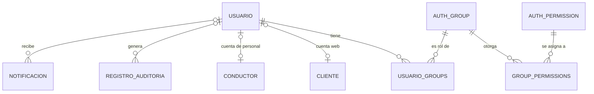
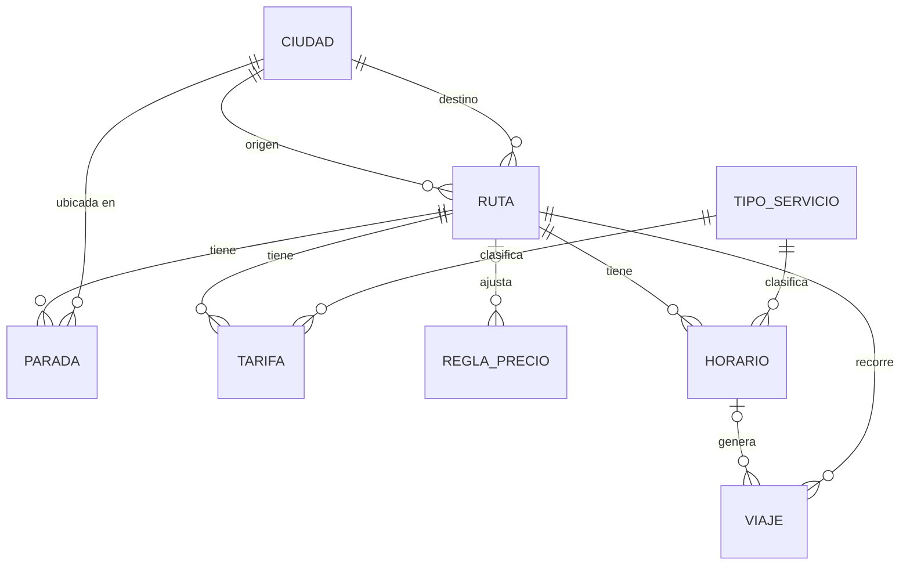
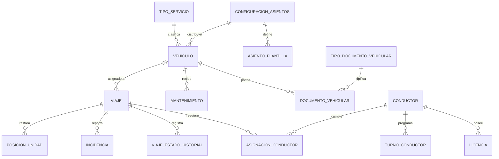
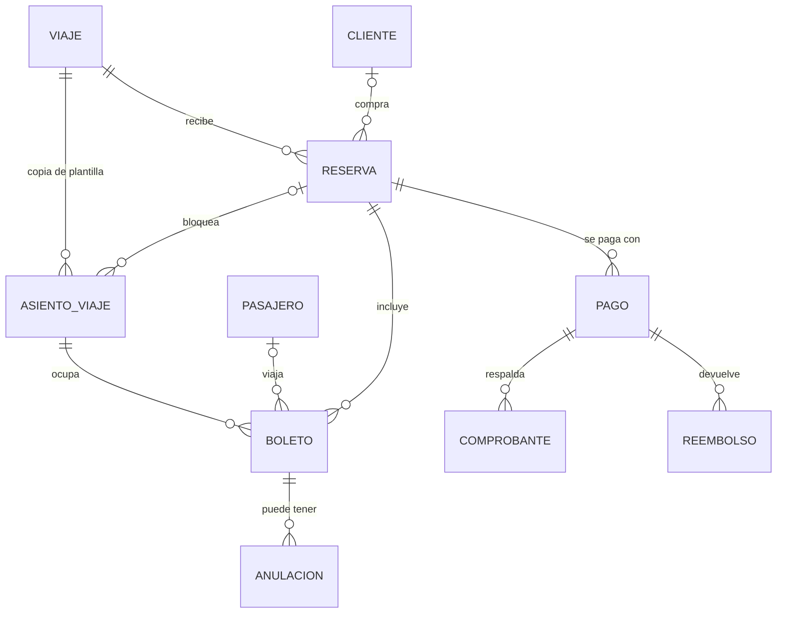
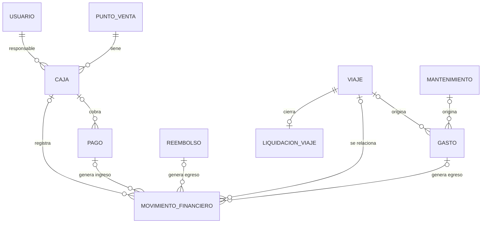

# Modelo de datos de GH BUS

Diseño de la base de datos (Paso 8). Motor: **MySQL 8.4 / InnoDB**, `utf8mb4`. Acceso y escritura únicamente a través del ORM de Django.
Este documento es el contrato: los modelos de cada app se escriben a partir de él.

## 0. Convenciones

| Tema | Regla |
|---|---|
| Nombres | Tablas y columnas en español, `snake_case`, singular (`viaje`, `asiento_viaje`). |
| Claves | `id BIGINT AUTO_INCREMENT` como PK en todas las tablas. |
| Dinero | `DECIMAL(12,2)` (tarifas `DECIMAL(10,2)`), moneda `PEN`. Nunca `FLOAT`. Los precios incluyen IGV. |
| Fechas | `DATETIME(6)` guardado en UTC (`USE_TZ=True`); se muestra en hora de Lima. Fechas puras en `DATE`. |
| Sellos | Toda tabla de negocio lleva `created_at` y `updated_at`. |
| Borrado | **No se borran registros de negocio.** Se desactivan (`activo` / `activa`) o cambian de estado. Todas las FK usan `PROTECT`. El «historial» sale de `registro_auditoria` y de las tablas de estado. |
| Integridad | `CHECK` de MySQL 8 para invariantes (se aplican desde 8.0.16). `UNIQUE` para duplicidades. Las reglas que MySQL no puede expresar (solapamiento de horarios) las aplica el servicio con bloqueos de fila. |
| Datos personales | Se guarda solo lo necesario. **Jamás** números de tarjeta ni CVV: la pasarela los maneja y aquí solo queda la referencia de la transacción. |
| Enumeraciones | `CharField` con `choices` en Django (se guardan como texto) para poder añadir valores sin migración compleja. |

## 1. Decisiones de diseño (confirmar)

| # | Decisión | Motivo |
|---|---|---|
| D1 | **Roles = `auth_group` de Django; permisos = `auth_permission`.** Los 5 perfiles se crean como grupos. El JWT lleva el claim `roles`. | Reutiliza `user.has_perm()` y el admin; evita reinventar tablas `rol`/`permiso`. |
| D2 | **El asiento se vende para el viaje completo** (no por tramos). Las paradas intermedias son informativas y el boleto puede indicar dónde sube/baja. | Venta por tramos obliga a manejar ocupación por segmento; complica mucho la regla «un asiento no se vende dos veces». Se puede añadir en una versión futura. |
| D3 | **Cada viaje tiene su propia copia de asientos** (`asiento_viaje`), generada desde la plantilla del vehículo al asignarlo. | Permite bloquear/vender/inhabilitar asientos por viaje y es el punto donde se garantiza la no duplicidad. |
| D4 | **El boleto nace al bloquear el asiento** (estado `RESERVADO`, sin QR) y pasa a `EMITIDO` (con QR único) al aprobarse el pago. | Una sola entidad cubre reserva, venta y embarque; el QR solo existe si hay pago (regla 5). |
| D5 | **Los movimientos financieros son inmutables.** Un error se corrige con un movimiento de reversa, no editando. | Trazabilidad contable y auditoría. |
| D6 | **Ventas online sin caja física:** `movimiento_financiero.caja_id` es opcional solo si `canal = ONLINE`. Los pagos en efectivo exigen una caja abierta. | El efectivo siempre tiene responsable; la pasarela no. |
| D7 | **Parámetros en tabla `configuracion`** (minutos de bloqueo, margen entre viajes, IGV, etc.). | Cambiarlos no requiere desplegar código. |
| D8 | **Tarifa vigente por fechas** + reglas de ajuste (temporada, horario, demanda) que multiplican el precio base. El precio final se **congela** en el viaje y en cada boleto. | Cambiar una tarifa no altera boletos ya vendidos. |

## 2. Mapa de tablas por app (40 tablas propias)

| App | Tablas |
|---|---|
| `users` | `usuario` (+ `auth_group`, `auth_permission` y sus tablas puente de Django) |
| `passengers` | `cliente`, `pasajero` |
| `routes` | `ciudad`, `tipo_servicio`, `ruta`, `parada`, `tarifa`, `regla_precio`, `horario` |
| `fleet` | `configuracion_asientos`, `asiento_plantilla`, `vehiculo`, `tipo_documento_vehicular`, `documento_vehicular`, `mantenimiento` |
| `drivers` | `conductor`, `licencia`, `turno_conductor` |
| `trips` | `viaje`, `asignacion_conductor`, `viaje_estado_historial` |
| `operations` | `incidencia`, `posicion_unidad`, `configuracion`, `notificacion` |
| `reservations` | `reserva`, `asiento_viaje` |
| `tickets` | `boleto`, `anulacion` |
| `finance` | `punto_venta`, `caja`, `pago`, `reembolso`, `serie_comprobante`, `comprobante`, `gasto`, `movimiento_financiero`, `liquidacion_viaje` |
| `audit` | `registro_auditoria` |
| `reports` | *(sin tablas: consultas y vistas sobre las anteriores)* |

## 3. Diagramas entidad-relación

### 3.1 Seguridad y personas


### 3.2 Rutas, tarifas y horarios


### 3.3 Flota, conductores y operación


### 3.4 Venta de boletos


### 3.5 Finanzas


## 4. Detalle de tablas

Notación: `FK` = clave foránea (siempre `PROTECT`), `?` = admite NULL, `UQ` = único, `CK` = restricción CHECK, `IX` = índice.
Los campos `created_at`, `updated_at` existen en todas las tablas de negocio y no se repiten abajo.

### 4.1 users
```
usuario  (modelo propio, extiende AbstractUser)
  username UQ · email UQ · password (hash) · first_name · last_name
  telefono VARCHAR(20) · is_active · is_staff · is_superuser · last_login · date_joined
```
Roles iniciales (grupos): `administrador`, `despachador`, `cajero`, `conductor`, `cliente`.

### 4.2 passengers
```
cliente                                   -- quien compra / recibe el comprobante
  usuario_id FK? UQ                       -- cuenta web opcional (1:1)
  tipo_documento (DNI|CE|PASAPORTE|RUC) · numero_documento VARCHAR(15)
  nombre VARCHAR(150)                     -- nombre completo o razón social
  telefono · email · direccion_fiscal VARCHAR(200)? · activo
  UQ (tipo_documento, numero_documento)

pasajero                                  -- quien viaja
  tipo_documento (DNI|CE|PASAPORTE) · numero_documento VARCHAR(15)
  nombres · apellidos · fecha_nacimiento DATE? · telefono · email?
  UQ (tipo_documento, numero_documento)
  IX (apellidos, nombres)
```
El historial de compras sale de `reserva.cliente_id`; el de viajes, de `boleto.pasajero_id`.

### 4.3 routes
```
ciudad
  nombre · departamento · activa
  UQ (nombre, departamento)

tipo_servicio                             -- p. ej. Comfort Class
  codigo UQ · nombre · descripcion · activo

ruta
  codigo UQ · nombre
  origen_id FK ciudad · destino_id FK ciudad
  distancia_km DECIMAL(7,1)? · duracion_min INT · activa
  CK origen_id <> destino_id · CK duracion_min > 0

parada                                    -- solo paradas intermedias
  ruta_id FK · ciudad_id FK · orden SMALLINT · minutos_desde_origen INT · direccion?
  UQ (ruta_id, orden) · UQ (ruta_id, ciudad_id) · CK minutos_desde_origen >= 0

tarifa
  ruta_id FK · tipo_servicio_id FK · monto DECIMAL(10,2)
  vigente_desde DATE · vigente_hasta DATE? · activa
  UQ (ruta_id, tipo_servicio_id, vigente_desde)
  CK monto > 0 · CK vigente_hasta IS NULL OR vigente_hasta >= vigente_desde
  (no solapamiento de vigencias: lo valida el servicio)

regla_precio                              -- temporada / horario / demanda
  nombre · ruta_id FK? (NULL = todas) · tipo (TEMPORADA|HORARIO|DEMANDA)
  fecha_desde? · fecha_hasta? · hora_desde? · hora_hasta? · dias_semana TINYINT? (bitmask)
  ocupacion_minima_pct TINYINT? · factor DECIMAL(5,3)   -- 1.150 = +15 %
  prioridad SMALLINT · activa
  CK factor > 0

horario                                   -- plantilla de salida recurrente
  ruta_id FK · tipo_servicio_id FK · hora_salida TIME
  dias_semana TINYINT (bitmask 1..127) · vigente_desde DATE · vigente_hasta DATE? · activo
  UQ (ruta_id, tipo_servicio_id, hora_salida, vigente_desde)
```
Precio de un viaje = tarifa vigente × factor de la regla aplicable de mayor prioridad. Se guarda en `viaje.precio_base`; las reglas de **demanda** se evalúan al vender y el precio final queda en `boleto.precio`.

### 4.4 fleet
```
configuracion_asientos                    -- distribución de un modelo de bus
  nombre UQ · pisos TINYINT · total_asientos SMALLINT

asiento_plantilla
  configuracion_id FK · numero SMALLINT · piso TINYINT · fila SMALLINT · columna SMALLINT
  categoria (VENTANA|PASILLO|ESPECIAL)?
  UQ (configuracion_id, numero) · UQ (configuracion_id, piso, fila, columna)

vehiculo
  placa VARCHAR(10) UQ · marca · modelo · anio SMALLINT
  configuracion_asientos_id FK · tipo_servicio_id FK
  caracteristicas JSON? · kilometraje INT?
  estado (DISPONIBLE|EN_VIAJE|MANTENIMIENTO|FUERA_DE_SERVICIO) · activo
  IX (estado)                             -- capacidad = configuracion_asientos.total_asientos

tipo_documento_vehicular
  codigo UQ (SOAT, REV_TECNICA, …) · nombre
  bloquea_asignacion BOOL · dias_alerta SMALLINT DEFAULT 30

documento_vehicular
  vehiculo_id FK · tipo_id FK · numero · fecha_emision · fecha_vencimiento · archivo VARCHAR(255)?
  CK fecha_vencimiento >= fecha_emision
  IX (vehiculo_id, tipo_id, fecha_vencimiento) · IX (fecha_vencimiento)

mantenimiento
  vehiculo_id FK · tipo (PREVENTIVO|CORRECTIVO)
  estado (PROGRAMADO|EN_PROCESO|COMPLETADO|CANCELADO)
  descripcion · fecha_inicio · fecha_fin? · kilometraje? · costo DECIMAL(12,2)? · proveedor?
  registrado_por_id FK usuario
  CK fecha_fin IS NULL OR fecha_fin >= fecha_inicio
  IX (vehiculo_id, fecha_inicio)
```

### 4.5 drivers
```
conductor
  usuario_id FK? UQ · dni CHAR(8) UQ · nombres · apellidos
  telefono · direccion · fecha_nacimiento? · activo

licencia
  conductor_id FK · numero VARCHAR(20) UQ
  categoria (A-I|A-IIa|A-IIb|A-IIIa|A-IIIb|A-IIIc)
  fecha_emision · fecha_vencimiento · activa
  CK fecha_vencimiento >= fecha_emision
  IX (conductor_id, fecha_vencimiento)

turno_conductor
  conductor_id FK · tipo (TURNO|DESCANSO|VACACIONES) · inicio · fin · observaciones?
  CK fin > inicio · IX (conductor_id, inicio, fin)
```

### 4.6 trips
```
viaje
  codigo VARCHAR(20) UQ
  ruta_id FK · tipo_servicio_id FK · horario_id FK?
  salida_programada · llegada_programada
  vehiculo_id FK?                         -- se asigna antes de despachar
  estado (PROGRAMADO|CONFIRMADO|EN_EMBARQUE|EN_RUTA|RETRASADO|FINALIZADO|CANCELADO)
  precio_base DECIMAL(10,2)
  salida_real? · llegada_real? · observaciones TEXT?
  creado_por_id FK usuario
  UQ (horario_id, salida_programada)      -- evita generar dos veces el mismo viaje
  CK llegada_programada > salida_programada
  CK llegada_real IS NULL OR salida_real IS NOT NULL
  CK estado NOT IN ('EN_EMBARQUE','EN_RUTA') OR vehiculo_id IS NOT NULL
  IX (estado, salida_programada) · IX (ruta_id, salida_programada)
  IX (vehiculo_id, salida_programada, llegada_programada)

asignacion_conductor
  viaje_id FK · conductor_id FK · rol (PRINCIPAL|COPILOTO) · activa
  asignado_por_id FK usuario · asignado_en
  UQ (viaje_id, conductor_id) · IX (conductor_id, activa)
  (un único PRINCIPAL activo por viaje: lo valida el servicio)

viaje_estado_historial
  viaje_id FK · estado_anterior? · estado_nuevo · cambiado_por_id FK? · cambiado_en · observacion?
  IX (viaje_id, cambiado_en)
```

### 4.7 operations
```
incidencia
  viaje_id FK · vehiculo_id FK? · conductor_id FK?
  tipo (MECANICA|RETRASO|ACCIDENTE|CLIMA|PASAJERO|OTRO) · severidad (BAJA|MEDIA|ALTA)
  descripcion · ocurrida_en · resuelta · resolucion?
  registrada_por_id FK usuario
  IX (viaje_id) · IX (tipo, ocurrida_en)

posicion_unidad                           -- alto volumen, solo se inserta
  viaje_id FK · latitud DECIMAL(9,6) · longitud DECIMAL(9,6)
  velocidad_kmh SMALLINT? · registrada_en
  IX (viaje_id, registrada_en)            -- se purga según política de retención

configuracion
  clave UQ · valor VARCHAR(255) · descripcion · updated_by_id FK?

notificacion
  usuario_id FK? · audiencia (USUARIO|PERSONAL) · tipo · titulo · mensaje
  clave_dedupe VARCHAR(100)? UQ           -- evita alertas repetidas (p. ej. «SOAT:12:30d»)
  leida_en?
  CK usuario_id IS NOT NULL OR audiencia = 'PERSONAL'
  IX (usuario_id, leida_en)
```

### 4.8 reservations
```
reserva
  codigo VARCHAR(12) UQ · viaje_id FK · cliente_id FK?
  canal (WEB|TAQUILLA) · estado (PENDIENTE|CONFIRMADA|EXPIRADA|CANCELADA)
  expira_en? · total DECIMAL(12,2) · creado_por_id FK usuario?   -- cajero si es taquilla
  CK estado <> 'PENDIENTE' OR expira_en IS NOT NULL
  IX (estado, expira_en) · IX (viaje_id, estado) · IX (cliente_id, created_at)

asiento_viaje                             -- copia de asiento_plantilla por viaje
  viaje_id FK · numero · piso · fila · columna
  estado (LIBRE|BLOQUEADO|VENDIDO|INHABILITADO)
  reserva_id FK? · bloqueado_hasta?
  UQ (viaje_id, numero)
  CK (estado IN ('LIBRE','INHABILITADO') AND reserva_id IS NULL AND bloqueado_hasta IS NULL)
     OR (estado = 'BLOQUEADO' AND reserva_id IS NOT NULL AND bloqueado_hasta IS NOT NULL)
     OR (estado = 'VENDIDO'   AND reserva_id IS NOT NULL AND bloqueado_hasta IS NULL)
  IX (viaje_id, estado) · IX (estado, bloqueado_hasta)
```

### 4.9 tickets
```
boleto
  reserva_id FK · viaje_id FK (copia del de la reserva) · asiento_viaje_id FK
  pasajero_id FK?                         -- se completa antes de pagar
  precio DECIMAL(10,2)
  estado (RESERVADO|EMITIDO|ABORDADO|ANULADO|REEMBOLSADO|EXPIRADO)
  codigo_qr CHAR(43)? UQ                  -- token aleatorio de 256 bits, solo existe si hay pago
  vigente BOOL?                           -- 1 mientras ocupa el asiento; NULL si ya no
  parada_subida_id FK? · parada_bajada_id FK?
  emitido_en? · abordado_en? · abordado_por_id FK usuario?
  UQ (asiento_viaje_id, vigente)          -- un asiento no puede tener dos boletos vigentes
  CK (estado IN ('RESERVADO','EMITIDO','ABORDADO') AND vigente = 1)
     OR (estado IN ('ANULADO','REEMBOLSADO','EXPIRADO') AND vigente IS NULL)
  CK estado NOT IN ('EMITIDO','ABORDADO') OR (codigo_qr IS NOT NULL AND pasajero_id IS NOT NULL)
  CK estado <> 'ABORDADO' OR abordado_en IS NOT NULL
  IX (viaje_id, estado) · IX (pasajero_id, created_at) · IX (reserva_id)

anulacion
  boleto_id FK · tipo (CANCELACION_CLIENTE|ANULACION_TAQUILLA|VIAJE_CANCELADO)
  motivo · monto_reembolso DECIMAL(10,2) DEFAULT 0
  solicitada_por_id FK usuario · autorizada_por_id FK usuario?
  CK tipo <> 'ANULACION_TAQUILLA' OR autorizada_por_id IS NOT NULL
  IX (boleto_id)
```
El truco `vigente`: MySQL no admite índices únicos parciales, pero sí permite varios `NULL` en un índice único. Así `UNIQUE (asiento_viaje_id, vigente)` impide dos boletos vigentes en el mismo asiento y deja conservar el historial de los anulados.

### 4.10 finance
```
punto_venta
  nombre UQ · ciudad_id FK · tipo (TAQUILLA|ONLINE) · activo

caja
  punto_venta_id FK · responsable_id FK usuario · estado (ABIERTA|CERRADA)
  apertura_en · monto_apertura DECIMAL(12,2)
  cierre_en? · monto_cierre_declarado? · monto_cierre_sistema? · diferencia? · cerrada_por_id FK?
  observaciones?
  abierta_vigente BOOL?                   -- 1 si ABIERTA, NULL si cerrada
  UQ (responsable_id, abierta_vigente)    -- una sola caja abierta por cajero
  CK (estado = 'ABIERTA' AND abierta_vigente = 1) OR (estado = 'CERRADA' AND abierta_vigente IS NULL AND cierre_en IS NOT NULL)
  IX (punto_venta_id, apertura_en)

pago
  reserva_id FK · monto DECIMAL(12,2) · moneda CHAR(3) DEFAULT 'PEN'
  medio (EFECTIVO|TRANSFERENCIA|TARJETA|YAPE|PLIN|OTRO)
  proveedor VARCHAR(30)? (p. ej. izipay) · referencia_externa VARCHAR(100)?
  estado (PENDIENTE|APROBADO|RECHAZADO|EXPIRADO|REEMBOLSADO)
  clave_idempotencia CHAR(36) UQ          -- un mismo intento no se cobra dos veces
  respuesta_proveedor JSON?               -- sin datos de tarjeta
  caja_id FK? · registrado_por_id FK? · aprobado_en?
  UQ (proveedor, referencia_externa)
  CK monto > 0 · CK medio <> 'EFECTIVO' OR caja_id IS NOT NULL
  IX (estado, created_at) · IX (reserva_id)

reembolso
  pago_id FK · anulacion_id FK? · monto DECIMAL(12,2)
  estado (PENDIENTE|APROBADO|RECHAZADO) · referencia_externa?
  autorizado_por_id FK usuario
  CK monto > 0       (suma de reembolsos <= monto del pago: lo valida el servicio)

serie_comprobante
  tipo (BOLETA|FACTURA|NOTA_CREDITO|NOTA_DEBITO) · serie CHAR(4)
  correlativo_actual INT DEFAULT 0 · punto_venta_id FK? · activa
  UQ (tipo, serie)

comprobante
  pago_id FK · tipo · serie CHAR(4) · numero INT
  receptor_tipo_documento · receptor_numero_documento · receptor_nombre · receptor_direccion?
  moneda · subtotal · igv · total
  estado (PENDIENTE|ACEPTADO|RECHAZADO|ANULADO)
  proveedor VARCHAR(30)? (p. ej. nubefact) · sunat_mensaje? · hash? · url_pdf? · url_xml?
  comprobante_referencia_id FK? (notas de crédito/débito) · emitido_en
  UQ (tipo, serie, numero)
  CK total = subtotal + igv
  IX (pago_id) · IX (estado)

gasto
  categoria (COMBUSTIBLE|PEAJE|VIATICOS|MANTENIMIENTO|OTRO)
  viaje_id FK? · mantenimiento_id FK? · monto DECIMAL(12,2) · fecha DATE
  descripcion · documento_referencia? · registrado_por_id FK usuario
  CK viaje_id IS NOT NULL OR mantenimiento_id IS NOT NULL      -- regla 9
  CK monto > 0
  IX (viaje_id) · IX (fecha)

movimiento_financiero                     -- inmutable (D5)
  caja_id FK? · tipo (INGRESO|EGRESO) · canal (PRESENCIAL|ONLINE)
  medio · monto DECIMAL(12,2) · concepto
  pago_id FK? · gasto_id FK? · reembolso_id FK? · viaje_id FK?
  reversa_de_id FK? (auto-referencia) · creado_por_id FK?
  CK monto > 0
  CK (tipo = 'INGRESO' AND pago_id IS NOT NULL)
     OR (tipo = 'EGRESO' AND (gasto_id IS NOT NULL OR reembolso_id IS NOT NULL))   -- regla 9
  CK canal = 'ONLINE' OR caja_id IS NOT NULL
  CK tipo = 'EGRESO' OR viaje_id IS NOT NULL
  IX (caja_id, created_at) · IX (tipo, created_at) · IX (viaje_id)

liquidacion_viaje
  viaje_id FK UQ · total_ingresos · total_gastos · utilidad
  estado (BORRADOR|CERRADA) · calculada_en · cerrada_por_id FK? · cerrada_en? · observaciones?
  CK utilidad = total_ingresos - total_gastos
```
Saldo de una caja = `monto_apertura` + ingresos en efectivo − egresos en efectivo de esa caja.

### 4.11 audit
```
registro_auditoria                        -- solo se inserta
  usuario_id FK? (SET NULL) · usuario_nombre VARCHAR(150)       -- copia por si el usuario cambia
  accion (CREAR|MODIFICAR|ELIMINAR|CANCELAR|ANULAR|LOGIN|LOGIN_FALLIDO|LOGOUT|PERMISO_DENEGADO|CIERRE_CAJA|OTRO)
  entidad VARCHAR(60) · entidad_id VARCHAR(40)? · cambios JSON? (antes/después)
  ip VARCHAR(45)? · user_agent VARCHAR(255)? · creado_en DATETIME(6)
  IX (entidad, entidad_id) · IX (usuario_id, creado_en) · IX (accion, creado_en) · IX (creado_en)
```
Endurecimiento para producción: usar para la aplicación un usuario de MySQL con `INSERT, SELECT` (sin `UPDATE`/`DELETE`) sobre esta tabla, y otro usuario solo para migraciones.

## 5. Las 10 reglas de negocio y dónde se garantizan

| # | Regla | En la base de datos | En el servicio (Django) |
|---|---|---|---|
| 1 | Un vehículo no puede estar en dos viajes a la vez | Índice `(vehiculo_id, salida_programada, llegada_programada)` | Bloqueo de la fila del vehículo + búsqueda de solapamiento con margen (§6.4). MySQL no tiene restricciones de exclusión. |
| 2 | Un conductor no puede tener horarios incompatibles | Índices de `asignacion_conductor` y `turno_conductor` | Igual que la 1, más descanso mínimo y turnos/vacaciones (§6.4). |
| 3 | Un asiento no se vende dos veces por viaje | `UQ (viaje_id, numero)`, `CK` de estado en `asiento_viaje`, `UQ (asiento_viaje_id, vigente)` en `boleto` | Bloqueo de filas de asientos en orden fijo (§6.1). |
| 4 | La reserva temporal expira | `bloqueado_hasta`, `expira_en` con `CK` | Expiración al consultar + comando `expirar_reservas` cada minuto (§6.1). |
| 5 | Un boleto pagado tiene QR único | `CK` (EMITIDO ⇒ QR) + `UQ codigo_qr` | El QR se genera al aprobar el pago, en la misma transacción (§6.2). |
| 6 | Un boleto usado no se reutiliza | `CK` (ABORDADO ⇒ `abordado_en`) | `UPDATE` condicional atómico (§6.3). |
| 7 | No se despacha sin vehículo y conductor habilitados | `CK` en `viaje`: EN_EMBARQUE/EN_RUTA exigen vehículo | Verifica conductor, licencia, documentos y estado del vehículo al cambiar de estado. |
| 8 | Documentos vencidos alertan y bloquean | `tipo_documento_vehicular.bloquea_asignacion` y `dias_alerta` | Bloquea la asignación; comando `generar_alertas` crea `notificacion` (sin duplicados por `clave_dedupe`). |
| 9 | Ingresos y gastos ligados a su operación | `CK` en `movimiento_financiero` y `gasto` | Al registrar pagos y gastos se completa la referencia. |
| 10 | Cancelaciones y cambios importantes quedan registrados | `CK` de autorización en `anulacion`; `viaje_estado_historial` | Cada operación sensible escribe en `registro_auditoria`. |

## 6. Algoritmos críticos

### 6.1 Bloquear asientos (reserva)
```
transacción atómica (aislamiento READ COMMITTED):
  1. validar viaje: estado abierto a la venta y salida futura
  2. SELECT … FROM asiento_viaje WHERE viaje_id = ? AND numero IN (…)
        ORDER BY numero FOR UPDATE            -- orden fijo: evita interbloqueos
  3. por cada asiento BLOQUEADO con bloqueado_hasta <= ahora (reserva abandonada):
        boleto → EXPIRADO (vigente = NULL) · reserva → EXPIRADA · asiento → LIBRE
        (debe hacerse ANTES de crear el nuevo boleto, o chocaría con UQ vigente)
  4. si algún asiento no está LIBRE → deshacer todo y responder 409 con la lista
  5. crear reserva (PENDIENTE, expira_en = ahora + minutos de bloqueo)
  6. asientos → BLOQUEADO (reserva_id, bloqueado_hasta)
  7. crear boletos RESERVADO (vigente = 1, precio congelado)
  8. al confirmar la transacción: publicar `seat.updated` por cada asiento
```

### 6.2 Confirmar pago
```
transacción atómica:
  1. SELECT reserva FOR UPDATE; el pago se identifica por clave_idempotencia / referencia_externa
     (si ya está APROBADO, responder lo mismo: el webhook puede llegar repetido)
  2. verificar que los asientos siguen bloqueados por ESTA reserva
     (si el pago llega tarde y otro los tomó → pago al flujo de reembolso)
  3. pago → APROBADO · asientos → VENDIDO (bloqueado_hasta = NULL)
  4. boletos → EMITIDO con codigo_qr = token aleatorio de 256 bits y emitido_en
  5. reserva → CONFIRMADA · movimiento INGRESO (con caja si es efectivo)
  6. comprobante PENDIENTE (numeración en §6.5)
  7. al confirmar: eventos `seat.updated`; el envío a SUNAT/Nubefact se hace aparte, con reintentos
```

### 6.3 Validar QR en el embarque (un solo uso)
```
UPDATE boleto
   SET estado = 'ABORDADO', abordado_en = NOW(6), abordado_por_id = :usuario
 WHERE codigo_qr = :qr AND viaje_id = :viaje AND estado = 'EMITIDO'
-- 1 fila afectada = válido y consumido. Dos lectores simultáneos: solo uno obtiene 1 fila.
-- 0 filas: consultar el motivo (no existe · otro viaje · ya abordó · anulado) para el mensaje.
```

### 6.4 Asignar vehículo o conductor
```
transacción atómica:
  1. SELECT vehiculo FOR UPDATE                    (conductor: SELECT conductor FOR UPDATE)
  2. rechazar si hay otro viaje activo que se solape:
        otro.salida < nuevo.llegada + margen  AND  otro.llegada + margen > nuevo.salida
        (margen = configuracion.margen_entre_viajes_min)
  3. vehículo: estado no en MANTENIMIENTO/FUERA_DE_SERVICIO, sin mantenimiento solapado,
        y sin documentos de tipos que bloquean vencidos antes de la llegada del viaje
  4. conductor: activo, licencia vigente hasta la llegada con categoría permitida,
        sin TURNO/DESCANSO/VACACIONES solapado y con el descanso mínimo respetado
  5. guardar y escribir en viaje_estado_historial / registro_auditoria
```

### 6.5 Numerar comprobantes
```
transacción atómica:
  SELECT serie_comprobante FOR UPDATE → correlativo_actual + 1 → INSERT comprobante
  (si la transacción falla, el número no se consume: no hay huecos)
  después de confirmar: enviar al proveedor (Nubefact) con reintentos; estado PENDIENTE → ACEPTADO/RECHAZADO
```

### 6.6 Cerrar caja
```
transacción atómica:
  SELECT caja FOR UPDATE · monto_cierre_sistema = apertura + ingresos efectivo − egresos efectivo
  diferencia = declarado − sistema · estado CERRADA, abierta_vigente = NULL · registro_auditoria
```

## 7. Datos semilla (migración de datos)

| Qué | Valores |
|---|---|
| Roles | `administrador`, `despachador`, `cajero`, `conductor`, `cliente` |
| `tipo_documento_vehicular` | SOAT y Revisión técnica (bloquean); Tarjeta de propiedad, Póliza, Permiso de operación (alertan) |
| `punto_venta` | «Venta online» (tipo ONLINE) |
| `configuracion` | ver tabla siguiente |

| Clave | Valor inicial | Nota |
|---|---|---|
| `bloqueo_asiento_minutos` | 10 | Tiempo para pagar antes de liberar el asiento |
| `margen_entre_viajes_min` | 60 | Margen entre viajes del mismo vehículo o conductor |
| `descanso_minimo_conductor_horas` | 8 | Ajustar con la normativa y la empresa |
| `categorias_licencia_permitidas` | `A-IIIa,A-IIIb,A-IIIc` | **Verificar con la normativa del MTC** |
| `igv_porcentaje` | 18 | |
| `dias_alerta_documentos` | 30 | Valor por defecto si el tipo no define uno |
| `politica_cancelacion` | *(a definir con la empresa)* | Plazos y % de reembolso |

## 8. Fuera del alcance de la versión 1
Venta por tramos · sobreventa · varias monedas · varias empresas · encomiendas/equipaje · programa de puntos · asientos con reglas de género.

## 9. Verificación del diseño contra MySQL real

El script [`verificacion_diseno.py`](verificacion_diseno.py) construye las tablas críticas con las restricciones de este documento y las ataca con conexiones simultáneas. Resultado: **35 de 35 comprobaciones pasan** (MySQL 8.0.46).

| Qué se comprobó | Resultado |
|---|---|
| 12 datos inconsistentes (viaje en ruta sin bus, asiento libre con reserva, boleto emitido sin QR, gasto sin operación, ingreso sin pago, etc.) | Todos rechazados por `CHECK` |
| Dos boletos vigentes en un asiento | Rechazado; tras anular se puede revender y el historial se conserva |
| 40 compradores simultáneos por el mismo asiento | Gana exactamente 1 |
| 60 compradores simultáneos por 3 asientos al azar entre 11 | Todo o nada, sin reservas a medias, **0 interbloqueos** |
| Reserva abandonada | Si no se expira primero el boleto viejo, el `UNIQUE` lo detiene; con el paso 3 del §6.1 el asiento se revende |
| 40 lectores escanean el mismo QR a la vez | Solo 1 lo valida |
| 30 intentos de asignar el mismo bus a viajes solapados | Con bloqueo de fila gana 1. **Sin bloqueo, MySQL dejó asignar los 30**: confirma que el bloqueo del §6.4 es indispensable |
| Dos cajas abiertas del mismo cajero | Rechazado |

Para repetirlo contra el MySQL de Docker (8.4), ver las instrucciones al inicio del script. Crea y borra solo la base temporal `proto`.

## 9.1 Cambios al implementar (Paso 10, parte 1)
Modelos escritos para `routes`, `fleet`, `drivers` y `operations.configuracion`. Diferencias respecto al diseño:
- `regla_precio` (temporada/horario/demanda) **se difiere** hasta el módulo Comercial; hoy el precio sale solo de `tarifa`.
- `documento_vehicular.archivo` **se omite**: aún no hay almacenamiento de archivos.
- `mantenimiento.fecha_inicio/fecha_fin` son `DATE` (el diseño no fijaba el tipo).
- `incidencia` ya existe (parte 2). `posicion_unidad` y `notificacion` **no** se construyeron: el aviso en vivo usa Socket.IO sin tabla.
- La no superposición de **tarifas** se valida en el serializador (no con bloqueo de fila): solo la edita el administrador.

## 9.2 Cambios al implementar (Paso 10, parte 2)
Modelos `viaje`, `asignacion_conductor`, `viaje_estado_historial` (app `trips`) e `incidencia`.
- El tipo de turno `TURNO` no bloquea la asignación; sí `DESCANSO` y `VACACIONES`. El hueco mínimo entre viajes de un conductor es el mayor entre el margen entre viajes y el descanso mínimo.
- El documento bloqueante debe estar vigente hasta la **llegada** del viaje, no solo a la salida.
- `precio_base` se congela desde la tarifa al crear el viaje; solo se edita en Programado/Confirmado.
- Restricciones en BD: (horario, salida_programada) único; llegada > salida; EN_EMBARQUE/EN_RUTA exigen vehículo; precio ≥ 0.
- Cancelar un viaje aún no trata boletos (llega con Comercial).

## 10. Pendiente de definir con la empresa
Política de cancelación y reembolsos · categorías de licencia exigidas · descanso mínimo de conductores · series de comprobantes asignadas por SUNAT/Nubefact · logotipo vectorial oficial.
